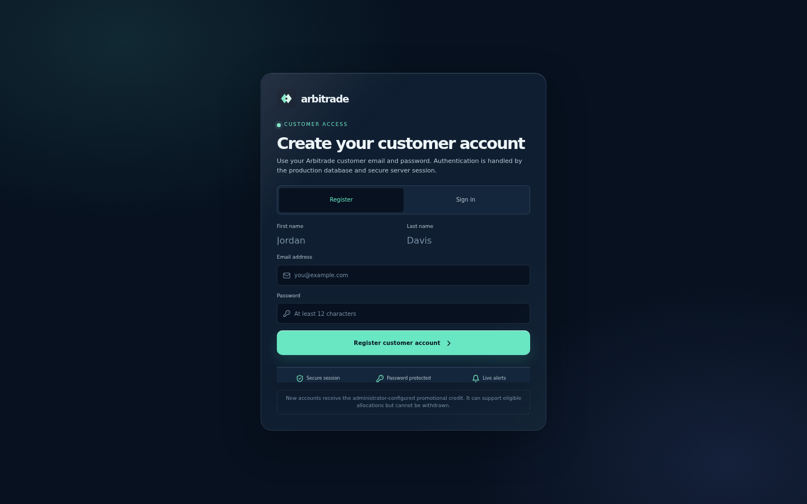
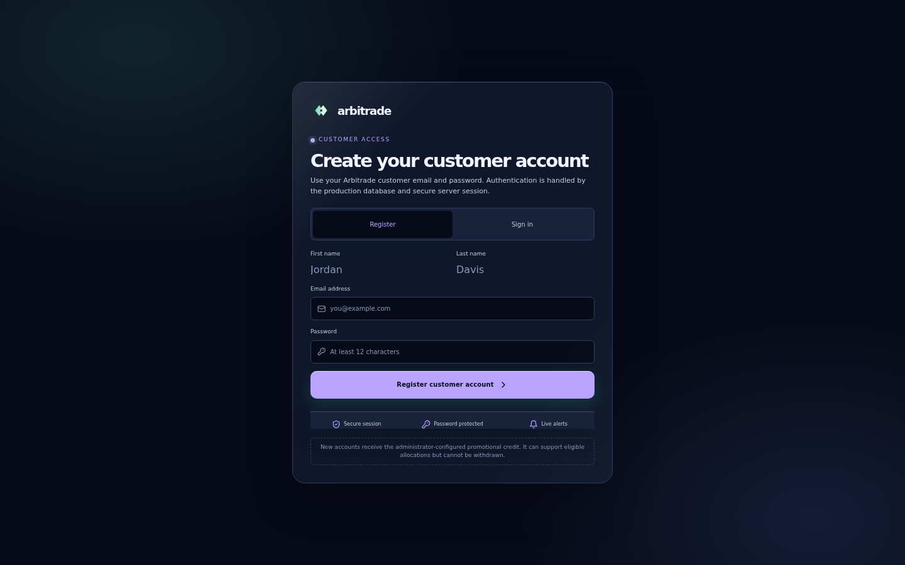
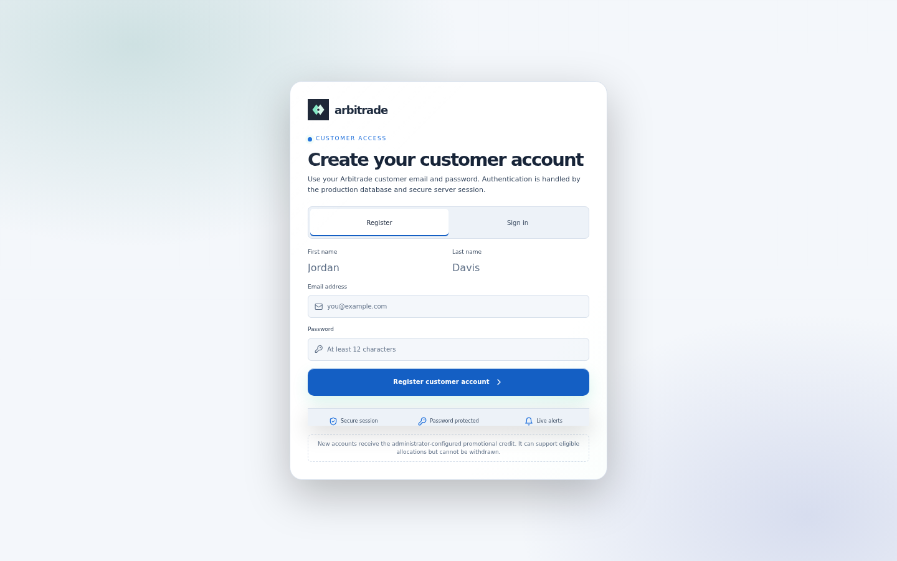
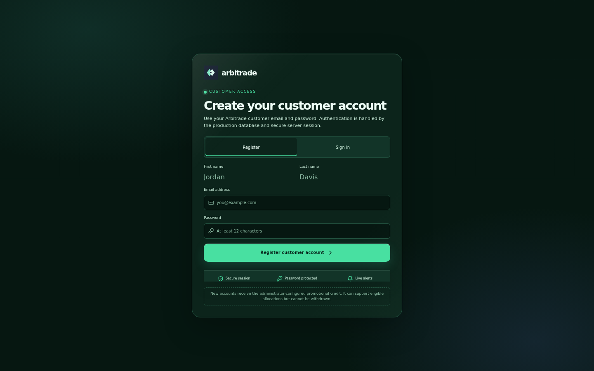
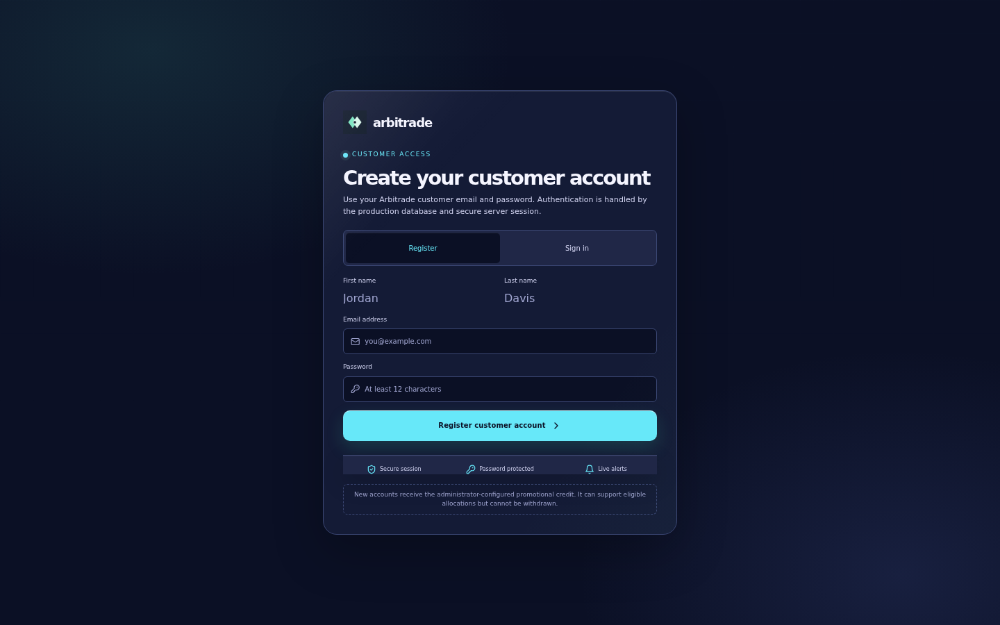

# ARBITRADE — actual browser theme screenshots

These are **real PNG screenshots captured from the browser acceptance run**, not SVG concept mockups. The screenshots show the customer registration page in each of the five implemented theme variants.

Desktop captures use a 1440px viewport; mobile captures use a 320px viewport.

## Original Arbitrade

[Open desktop PNG](original-desktop.png) · [Open mobile PNG](original-mobile.png)

## Midnight Premium

[Open desktop PNG](midnight-premium-desktop.png) · [Open mobile PNG](midnight-premium-mobile.png)

## Clean Light

[Open desktop PNG](clean-light-desktop.png) · [Open mobile PNG](clean-light-mobile.png)

## Emerald Finance

[Open desktop PNG](emerald-finance-desktop.png) · [Open mobile PNG](emerald-finance-mobile.png)

## Aurora Modern

[Open desktop PNG](aurora-modern-desktop.png) · [Open mobile PNG](aurora-modern-mobile.png)

## Validation evidence

The source browser-acceptance report recorded **1,172 checks passed and 0 failures** across the gateway, customer, and admin routes. These five screenshots are customer-route captures.
